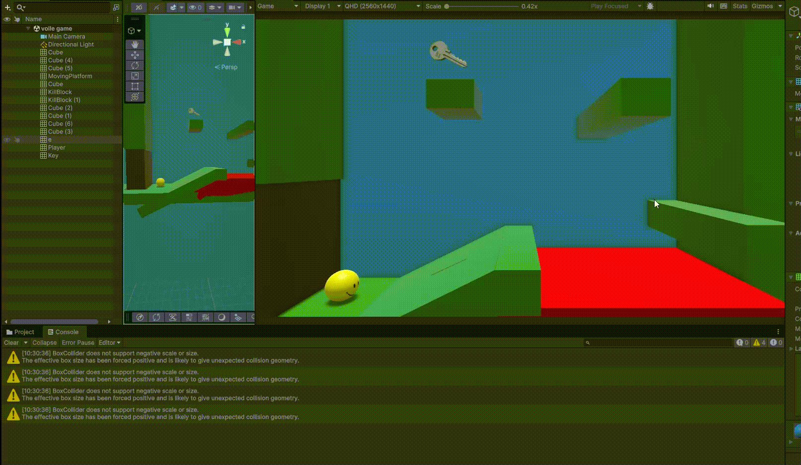

# Mini-level — Inleveren

**Naam:** Toby Kuijper
**Klas:** SD1C
**Datum:** 29 oktober 2026
**Les:** GDV Les 6

---

## Wat heb ik gemaakt?

Ik heb een mini-level gemaakt waarin je een bal bestuurt. Het doel is om de sleutel te pakken en daarmee door de deur te gaan. Als je dat doet, win je het level.

Onderweg moet je de lava vermijden. Raak je de lava aan, dan word je teruggezet naar het beginpunt. Na 5 keer dood gaan is het game over. Ook is er een bewegend platform waar je overheen moet.

---

## Screenshot / GIF van je level



---

## Bewegend object

In mijn level beweegt de sleutel (hij draait rond) en is er een bewegend platform dat omhoog en omlaag gaat.

**Rotatie van de sleutel:**

```csharp
using UnityEngine;

public class Rotatie : MonoBehaviour
{
    public float rotationSpeed = 100f; // graden per seconde

    void Update()
    {
        transform.Rotate(0, rotationSpeed * Time.deltaTime, 0);
    }
}
```

**Het bewegende platform:**

```csharp
using UnityEngine;

public class MovingCube : MonoBehaviour
{
    public float height = 2f;   // hoogte van de beweging
    public float speed = 1f;    // snelheid van de beweging
    Vector3 startPos;

    void Start()
    {
        startPos = transform.position;
    }

    void Update()
    {
        float offset = Mathf.Sin(Time.time * speed) * height;
        transform.position = startPos + Vector3.up * offset;
    }
}
```

Het platform gebruikt `Mathf.Sin`, waardoor het soepel op en neer beweegt vanaf de startpositie.

---

## Collider of trigger

| Object | Collider of trigger? | Wat gebeurt er? |
|---|---|---|
| Killblock (lava) | Trigger | Je wordt teruggezet naar de spawn-locatie en de dood-teller gaat omhoog. |
| Sleutel | Trigger | Je pakt de sleutel op. Hij wordt opgeslagen en het object verdwijnt. |
| Deur | Collider | De deur checkt of je de sleutel hebt. Zo ja, dan gaat de deur open. |

**Killblock:**

```csharp
using UnityEngine;

public class KillScript : MonoBehaviour
{
    public int deaths = 0;

    void OnTriggerEnter(Collider other)
    {
        if (other.CompareTag("Player"))
        {
            other.transform.position = new Vector3(-6.52f, 14.37f, 27.32f);
            deaths++;
            Debug.Log("Player has died. Total deaths: " + deaths);

            if (deaths == 5)
            {
                Debug.Log("GAME over!");
                transform.localScale = new Vector3(1000, 1000, 10);
                GetComponent<Renderer>().material.color = Color.black;
            }
        }
    }
}
```

**Sleutel (zit op de speler):**

```csharp
using UnityEngine;

public class KeyCollector : MonoBehaviour
{
    public int Key = 0;

    void OnTriggerEnter(Collider other)
    {
        if (other.CompareTag("Key"))
        {
            Key++;
            Destroy(other.gameObject);
            Debug.Log("Key collected: " + Key);
        }
    }
}
```

**Deur:**

```csharp
using UnityEngine;

public class OpenDoor : MonoBehaviour
{
    public float openHeight = 3f;
    public float openSpeed = 2f;

    Vector3 openPos;
    bool isOpen = false;

    void Start()
    {
        openPos = transform.position + Vector3.up * openHeight;
    }

    void OnCollisionEnter(Collision collision)
    {
        KeyCollector collector = collision.gameObject.GetComponent<KeyCollector>();

        if (collector != null && collector.Key >= 1)
        {
            isOpen = true;
        }
    }

    void Update()
    {
        if (isOpen)
        {
            transform.position = Vector3.MoveTowards(transform.position, openPos, openSpeed * Time.deltaTime);
        }
    }
}
```

---

## Logica met `if` of `switch`

Ik heb `if` gebruikt bij de deur en bij de killblock.

- **Deur:** als je de sleutel hebt en tegen de deur aan loopt, gaat hij open.
- **Killblock:** als je 5 keer dood bent gegaan, is het game over.

```csharp
// Deur: alleen openen als de speler minstens 1 sleutel heeft
if (collector != null && collector.Key >= 1)
{
    isOpen = true;
}

// Killblock: game over na 5 keer dood gaan
if (deaths == 5)
{
    Debug.Log("GAME over!");
    transform.localScale = new Vector3(1000, 1000, 10);
    GetComponent<Renderer>().material.color = Color.black;
}
```

---

## Eigen extra idee

Dit heb ik zelf bedacht:

- **Deur:** je moet de deur aanraken om hem te openen, en dat lukt alleen met een sleutel.
- **Killblock:** je mag maximaal 5 keer dood gaan. Daarna is het game over en wordt het scherm zwart.

```csharp
// Deze code staat hierboven bij "Collider of trigger" (OpenDoor en KillScript).
```

---

## Evaluatie

### Wat ging goed? en waarom?

Het ging over het algemeen goed. Vooral de killblock en de sleutel vond ik goed gaan. De sleutel was best simpel, omdat ik dezelfde code kon gebruiken als bij het coin-script.

### Wat vond je lastig? en waarom?

Het schrijven van sommige code vond ik lastig, vooral de volgorde waarin je dingen moet zetten en hoe je iets in C# opschrijft. Ik werk zelf vaak met Blueprints in Unreal Engine en dat werkt toch heel anders dan code typen.

### Wat zou je een volgende keer anders doen?

Ik zou vaker dingen opzoeken op Google, omdat ik dan sneller antwoorden vind. Het liefst zou ik ook in UE5 werken, omdat ik daar meer ervaring mee heb.
